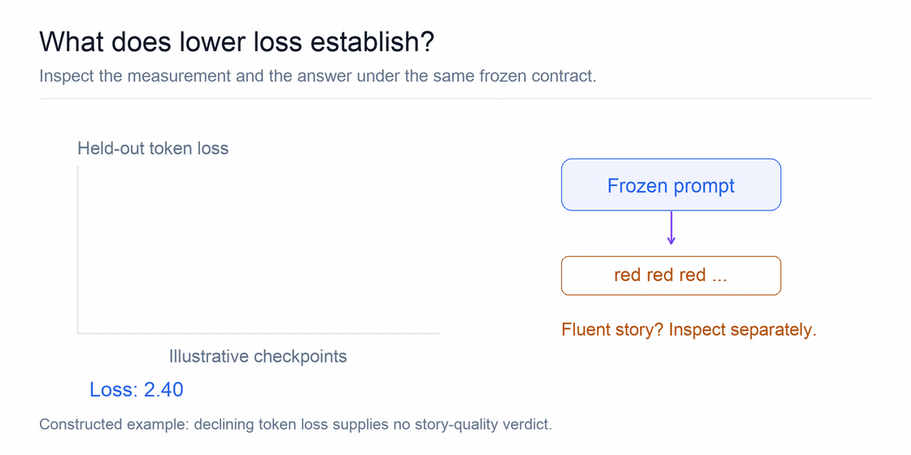

# Chapter 1 — Evidence Before Optimization

> The first principle is that you must not fool yourself—and you are the easiest
> person to fool.
>
> — Richard P. Feynman, "Cargo Cult Science," in *Surely You're Joking, Mr. Feynman!*

Companion: [guided laboratory route](../labs/01-evidence-before-optimization.md).

You probably start where most people start. You type a training command and wait.
The process ends without an error. Its loss is lower than it was one minute ago.
A checkpoint appears on disk. Did the model improve?

Perhaps—but none of those facts answers the question by itself.

Feynman's warning fits this moment exactly. Nobody is trying to deceive you. The
danger is that you wanted the run to work, the number moved the right way, and
it's easy to read more into it than it says. Language-model development is
unusually good at producing persuasive numbers. Losses move every step, rewards
can rise rapidly, samples are easy to cherry-pick, and modern frameworks can hide
thousands of implementation decisions behind a short command. The first skill of
model development is therefore not optimization. It's learning how to make a
claim that the evidence can actually support.

This chapter builds that discipline. We will use a three-step Qwen3-0.6B
fine-tuning run as a worked example. The run is small on purpose: it lets us
examine the logic of an experiment before scale makes the logic hard to see. We
take six steps:

1. Separate what a run recorded from what we conclude about it (§1.2).
2. Say exactly which experiment ran, and see why a seed alone can't make it
   repeat (§1.3–1.4).
3. Write the experiment's contract, with predictions and success criteria,
   before running it (§1.5).
4. Learn what the smallest kind of test can and can't show, and how to read
   memory on a machine where CPU and GPU share one pool (§1.6–1.7).
5. Apply all of it to a real three-step Qwen3-0.6B run, then extract a reusable
   reasoning pattern (§1.8–1.9).
6. Check that a checkpoint keeps its token meanings when it's handed to the next
   stage (§1.10).

## 1.1 Learning outcomes

After completing this chapter, you should be able to:

- identify the code, environment, data, model, configuration, seed, and hardware
  needed to describe an experiment;
- explain why a random seed does not guarantee identical results;
- write a hypothesis with observable success and failure conditions;
- design a comparison that changes one meaningful variable at a time;
- distinguish an observation, a supported interpretation, and an unsupported
  claim;
- explain what a smoke test establishes and what it leaves unknown;
- interpret system, cgroup, and CUDA memory measurements on a unified-memory
  machine without adding overlapping values.

**Prerequisites:** ordinary Python and a basic distinction between a model,
a training objective and a measurement. No large-model execution is required
to work through this chapter's evidence questions.

The practical reproduction instructions live in
[Appendix A](../appendices/a-laboratory-setup.md). The complete experiment contract
and evidence remain in the companion repository.

The [four Day 1 notebooks](../../notebooks/day-01/README.md) make the evidence
standard executable: canonical run identity, deliberately failed smoke criteria,
a read of the actual later TinyStories result, and a checkpoint/tokenizer
interface audit. They use CPU computations
and stored reports, with adjacent explanations and useful plots.

## 1.2 An experiment produces measurements, not conclusions

We start with the gap between a number and a conclusion. A run hands us numbers.
We want to say something about the model. Between the two sits a step we take
ourselves, and that step is where we can fool ourselves.

A fever thermometer shows the same gap. A reading that falls from 39 °C to 37.5 °C
is an observation. "The fever is coming down" is a reasonable interpretation of
that reading. "The infection is gone" is a claim the thermometer never measured.
A training log works the same way. Consider a hypothetical log:

```text
step 1: loss = 2.41
step 2: loss = 2.36
step 3: loss = 2.33
exit status: 0
```

We can state several things about it, but those statements do not have equal
status.

**Observation:** the reported loss decreased from 2.41 to 2.33, and the process
returned exit status 0. These values were directly recorded.

**Supported interpretation:** this particular execution completed three reported
steps. If the trainer's behavior and logs have also been inspected, the result is
evidence that the tested training path is operational.

**Unsupported claim:** the model acquired a generally useful capability. Nothing
in the log measures behavior on a held-out task, and three loss values cannot
establish generalization.

This gives us a basic evidence chain:

```text
configuration → execution → recorded observations → bounded interpretation
```

The last arrow is where many errors occur. An interpretation should not contain
more certainty or scope than the observations can carry.

### Decide which claim the log can carry

**Reader prediction.** Keep those three losses and exit status unchanged, but
suppose the saved checkpoint cannot be reopened. Did the experiment succeed?
The answer depends on the contract: a forward/backward execution check may pass,
while a training-and-save check fails. A favorable number cannot replace a
missing required observation.

Read the same log through three progressively stronger questions:

| Proposed claim | Evidence needed beyond the printed losses | Decision from this log alone |
|---|---|---|
| The process returned normally | Its actual exit status and complete record | Supported by the stated status |
| The intended training path works | Correct data and loss construction, expected updates, numerical checks, required saved outputs | Only partly supported |
| The model performs better on new requests | A declared held-out comparison, aligned scoring and representative responses | Unanswered |

This is a useful decision procedure: name the claim, list what could falsify it,
then ask whether those observations exist. A checkpoint is evidence that bytes
were saved; reopening it with the intended tokenizer tests a different property.
Likewise, a loss curve measures the chosen objective; a behavioral comparison
tests whether that objective delivered the desired result. We will follow one
small text sequence through the model in Chapters 2–6, then return to this gap
between prediction error and useful behavior in Chapter 7.

### Loss is not capability

Training loss answers a narrow question: how well does the current model predict
the selected training tokens under the selected objective? It does not directly
answer whether the model follows instructions better, solves new problems, becomes
more truthful, or retains earlier capabilities.

The common next-token loss is a negative natural logarithm, measured in **nats**.
It penalizes assigning little probability to an observed continuation. Chapter 3
will derive both that loss and its gradient. For a mean over many target tokens,
exponentiating its negative gives their geometric-mean assigned probability,
not the probability of every token and not a task success rate.

Even a perfectly measured reduction in training loss can coexist with:

- memorization rather than generalization;
- regression on unrelated tasks;
- worse generation behavior caused by changed formatting or termination;
- contamination between training and evaluation data;
- optimization of a proxy that does not represent the desired capability.

Later chapters will build evaluation contracts for those questions. For now, the
important habit is to name what a metric measures instead of calling it “better.”


<!-- chapter-gif: evidence-gap -->
**Predict:** Which observation would justify a claim about coherent stories?



*A constructed loss curve falls while the displayed response remains repetitive. Token loss and story quality need separate measurements.*

[Try the notebook](../../notebooks/day-01/02_smoke_criteria_and_claims.ipynb) · [View a still image](../../visuals/chapters/rendered/evidence-gap.png)
<!-- /chapter-gif: evidence-gap -->

## 1.3 The identity of an experiment

An observation is only useful if we know what produced it. If someone else (or
you, next month) can't tell which code, data and settings made a number, the
number can't be checked or compared. So before we judge results, we need a way
to name the experiment precisely.

A recipe that says "bake at 180 °C for 30 minutes" doesn't tell you which flour,
which oven or how big the tin was. Two bakers can follow it and get different
cakes. In the same way, “I trained Qwen3 with seed 42” does not identify a
reproducible experiment. A useful **experiment identity**, the full list of
things that determine what ran, is a tuple:

```math
\mathcal{E} = (C, L, H, M, \mathcal D, \mathcal K, s),
```

where:

- $`C`$ is the code revision, including local patches;
- $`L`$ is the locked software environment;
- $`H`$ is the relevant hardware and system identity;
- $`M`$ is the model and exact model revision;
- $`\mathcal D`$ is the dataset, revision, split, and selection procedure;
- $`\mathcal K`$ is the full experiment configuration, separate from model parameters;
- $`s`$ is the collection of random seeds.

The result should also retain its outputs and measurements. Without them, we know
what was intended but not what occurred.

### Code identity

A branch name such as `main` moves over time. Record an immutable commit hash. If
the working tree contains uncommitted changes, record that fact too: a commit hash
cannot identify modifications that exist only on one machine.

External trainers deserve the same treatment. Record the upstream revision and
the identity of any applied patch. “Latest open-instruct” is not an experiment
identity.

### Environment identity

A package list is useful, but a lock file is stronger because it describes the
dependency solution that should be recreated. Record both the lock file and a
cryptographic hash of its contents. The interpreter, CUDA runtime, and important
framework versions should also appear in the manifest so a reviewer can quickly
see what actually ran.

An import test is not sufficient. A library may import while a real GPU kernel
fails to compile or execute. Environment validation should exercise representative
operations: the attention backend, forward and backward computation, compilation,
and any custom kernels on which the experiment depends.

### Model and data identity

Repository names are mutable pointers. Record immutable model and dataset
revisions, the dataset split, filters, sample count, and ordering or selection
procedure. Two runs with the same model name and seed can still see different
tokens if the dataset changed or preprocessing was reordered.

### Configuration identity

The configuration includes more than the learning rate. At minimum, training work
should record:

- precision and attention backend;
- optimizer and schedule;
- microbatch size and gradient accumulation;
- sequence lengths and packing behavior;
- gradient checkpointing and clipping;
- total steps or token budget;
- random seeds;
- checkpoint source and output policy.

These fields define the computation. Omitting them makes comparisons ambiguous.

Here **precision** names the numerical storage and computation choices, such as
32-bit floating point (FP32) or 16-bit brain floating point (BF16). An attention
backend is the implementation used for the model's information-mixing operation.
A **microbatch** is the examples processed by one forward/backward pass;
gradient accumulation combines several such passes before one optimizer update.
Gradient checkpointing trades extra recomputation for storing fewer intermediate
activations. It differs from saving a model checkpoint to disk. The optimizer
uses gradients to change parameters, while its schedule changes the update size
over time. These names specify costs and behavior; later chapters expose their
mechanisms.

## 1.4 Reproducibility is larger than a seed

The identity in §1.3 includes a seed, and it's tempting to think the seed is what
makes a run repeatable. It isn't, or at least not by itself. This section shows
where else variation comes from, including from arithmetic itself.

A pseudorandom seed selects a repeatable stream for a particular random-number
generator. Training involves several possible generators and several other sources
of variation:

- dataset shuffling and worker processes;
- parameter initialization;
- dropout and sampling;
- asynchronous or nondeterministic GPU kernels;
- floating-point reduction order;
- compiler, driver, and framework changes;
- distributed communication order.

Floating-point addition is not associative:

```math
(a+b)+c \neq a+(b+c)
```

in finite precision. Two correct parallel reduction orders can therefore produce
slightly different values. During many optimization steps, small numerical
differences can lead to visibly different trajectories.

For a concrete FP32 example, set $`a=10^8`$, $`b=-10^8`$, and $`c=1`$.
Computing $`(a+b)+c`$ gives 1, while $`a+(b+c)`$ gives 0: at that magnitude,
adding 1 to $`b`$ rounds back to $`b`$. Written out step by step, with
$`\mathrm{fl}(\cdot)`$ meaning "round to the nearest FP32 value":

```math
(a+b)+c = (10^8-10^8)+1 = 0+1 = 1,
```

```math
a+(b+c) = 10^8+\mathrm{fl}(-10^8+1) = 10^8+(-10^8) = 0.
```

The rounding happens because FP32 numbers between $`2^{26}`$ and $`2^{27}`$ are
spaced 8 apart, and $`10^8`$ lies in that range. There is no FP32 value for
$`-10^8+1`$, so it rounds to the nearest neighbor, $`-10^8`$. The mathematical sum is the same; the
intermediate rounding differs. Fixing the random seed cannot fix a reduction
order that the execution backend changes.

In this book, **repeatability** means rerunning the recorded procedure in the same
controlled environment, while **reproducibility** means independently recreating
the result from its preserved identity and protocol. Terminology varies across
fields, so the operational definition matters more than the label.

The objective is not always bit-for-bit equality. The objective is to know which
variation is acceptable, which quantities should agree, and what evidence would
indicate a genuine implementation difference.

## 1.5 Write the experiment contract before execution

We can now name an experiment and say how much variation to expect. One danger
from §1.2 remains: deciding what counts as success *after* seeing the numbers.
The fix is to write the decision rule down first.

Think of a sealed envelope. Before the race, you write down which horse you
think will win and seal it. Afterward, nobody can argue about what you predicted.
A useful experiment begins the same way, as a contract rather than a command. It
answers five questions:

1. What question are we investigating?
2. What do we predict, and why?
3. What remains fixed, and what changes?
4. Which measurements decide the outcome?
5. What will the experiment explicitly not establish?

Compare these hypotheses:

> The training run should work.

and:

> Qwen3-0.6B will complete three BF16 full-SFT optimizer steps with SDPA,
> microbatch size 1, and sequence length 1024. Every reported loss will remain
> finite, expected model outputs will be saved, and whole-system available memory
> will remain above 24 GiB.

The second is useful because the result can contradict it. “Work” has been replaced
by observable conditions.

### Conjunctive success criteria

If a hypothesis requires execution **and** numerical validity **and** memory
safety, all three matter. Suppose training exits successfully but available memory
falls below the precommitted safety reserve. The execution claim is supported, but
the experiment fails its overall success criteria.

This prevents a common form of hindsight bias: redefining success around whichever
number looks favorable after the run.

The same principle applies to recovery: native child processes can finish
successfully while a required deadline, final-state comparison or supervised
cleanup condition fails. Preserve the passing observations and the failed
overall result. [Appendix D](../appendices/d-reproduction-and-environments.md#d6-checkpoints-recovery-and-job-supervision)
links the actual recovery cases and their unchanged failure records.

### Controlled comparisons

In a **controlled comparison**, two runs differ on purpose in one way. The
**independent variable** is the factor deliberately changed, the **dependent
variables** are the measured outcomes, and other important conditions are held
fixed.

If batch size 1 is safe, this is an interpretable next comparison:

```text
batch size:      1 → 2
sequence length: 1024
attention:       SDPA
everything else: fixed
```

Changing batch size, sequence length, and attention backend simultaneously might
be useful for testing a complete recipe, but it cannot isolate which change caused
the observed difference.

## 1.6 Smoke tests occupy the first rung of evidence

A contract tells us what to measure, but not how big the first experiment should
be. Long runs are expensive, and a bug found after ten hours costs ten hours. So
we begin with the smallest run that can fail in an informative way.

The name borrows from hardware: switch on a new circuit for the first time and
check that nothing starts smoking. Passing tells you the circuit didn't burn. It
doesn't tell you the circuit computes the right answer. A **smoke test** is the
software version, a short run that asks whether a narrow path through the system
executes. Depending on
the protocol, it may validate:

- model, tokenizer, and dataset loading;
- preprocessing and collation;
- forward computation and loss construction;
- backward computation and optimizer execution;
- metric logging and checkpoint saving;
- basic resource safety for the tested configuration.

It does not normally validate:

- useful capability improvement;
- convergence over a realistic token budget;
- stability over hours or days;
- the largest safe batch or sequence length;
- optimality relative to alternative recipes;
- identical behavior on another system.

A smoke test is valuable precisely because its claim is small. It catches basic
failures cheaply before a long experiment turns them into expensive failures.

We will use three experiment modes throughout the book:

| Mode | Typical duration | Primary question |
|---|---:|---|
| Smoke | 1–15 minutes | Does the intended path execute and record evidence? |
| Learning | 30 minutes–4 hours | Does a visible, interpretable learning signal appear? |
| Reference | 8–24+ hours | Does the conclusion survive a publication-quality comparison? |

Duration is a guide, not a definition. The claim and evidence standard define the
mode.

## 1.7 Memory on a unified-memory system

One of the smoke test's success criteria in §1.5 was a memory boundary. To check
it honestly, we have to know what our memory numbers mean. On the machine used in
this book, that's less obvious than it sounds.

On a conventional accelerator server, people often speak as though CPU RAM and
GPU VRAM were independent budgets. NVIDIA DGX Spark uses **unified memory**, one
physical pool that the CPU and GPU both draw from: CPU
allocations, CUDA allocations, model state, activations, optimizer state, Linux
file cache, and other processes draw from the same physical pool.

A rough decomposition of training pressure is:

```math
M_{\text{train}} \approx
M_{\text{weights}} + M_{\text{gradients}} + M_{\text{optimizer}}
+ M_{\text{activations}} + M_{\text{temporary}} + M_{\text{runtime}}.
```

Some terms are nearly fixed for a given model; activations and temporary buffers
depend on batch geometry, sequence length, attention implementation, and
checkpointing. This is why multiplying a batch-1 peak by eight is not a reliable
prediction for batch size 8.

### Size the state before interpreting a peak

**Reader prediction.** A model has one million trainable parameters. Its FP32
weights occupy four million bytes. Does an AdamW training step therefore need
only four million bytes for model state?

No. Under the explicitly chosen policy of FP32 weights, FP32 gradients and two
FP32 optimizer moment buffers, the persistent ledger is:

| State | Bytes per parameter | Bytes for one million parameters |
|---|---:|---:|
| Weights | 4 | 4,000,000 |
| Gradients | 4 | 4,000,000 |
| First moment: smoothed gradient history | 4 | 4,000,000 |
| Second moment: smoothed squared-gradient history | 4 | 4,000,000 |
| Total of these four terms | 16 | 16,000,000 |

These are decimal bytes, before activations, temporary buffers and runtime
overhead. Moment buffers may be allocated lazily at the first update, so a
forward-only observation can miss a cost that appears during training.

Now change only the declared storage policy: BF16 weights and gradients use two
bytes each, with the same FP32 moments. Those four terms become 12,000,000
bytes. Per parameter, the sum is:

```math
\underbrace{2}_{\text{weights}}+\underbrace{2}_{\text{gradients}}
+\underbrace{4}_{\text{first moment}}+\underbrace{4}_{\text{second moment}}
=12\ \text{bytes},
```

and $`12\times 10^6=12{,}000{,}000`$ bytes for one million parameters.
If that implementation also keeps an FP32 master copy of the weights,
add another 4,000,000 bytes. A “BF16 run” therefore does not identify the whole
memory budget. Inspect the actual optimizer and master-copy policy. The example
is arithmetic about stated storage choices; it does not assert how the later
Qwen smoke trainer stores every tensor.

This ledger explains the next experiment. Increasing the microbatch leaves
the parameter and moment counts fixed while increasing much of the activation
work. Increasing sequence length changes both stored states and attention
work. The measured peak combines those effects; the ledger tells us which
terms to investigate rather than scaling the entire peak blindly.

A shared household bank account helps with what comes next. Your card statement
and the joint account statement both list the same grocery purchase. Adding the
two statements together would count that purchase twice. Memory reports on a
unified-memory machine behave the same way. We preserve three views:

| View | What it tells us |
|---|---|
| Whole-system `MemAvailable` | Remaining headroom for the entire machine |
| Cgroup `memory.peak` | Peak memory charged to the isolated job scope |
| CUDA-visible process allocation | Allocation attributed through NVIDIA's process accounting |

These accounting domains overlap. They must not be added together. If a cgroup
peak is 7 GiB and CUDA-visible allocation is 6.4 GiB, reporting 13.4 GiB would
double-count some memory rather than reveal a more accurate total.

Capacity is established incrementally. Start with the smallest useful batch and
sequence, change one dimension at a time, monitor the whole-system reserve, and
stop before interactive work or the operating system is placed at risk.

## 1.8 Case study: a three-step Qwen3-0.6B smoke test

We now have every piece: a bounded claim (§1.2), an identity (§1.3), a contract
(§1.5), a smoke-test scope (§1.6) and a way to read memory (§1.7). Let's put them
together on one real run. We can now examine a real experiment without asking it
to prove more than it was designed to prove.

### Question and prediction

The question was whether the pinned DGX Spark open-instruct stack could complete
an existing Qwen3-0.6B full-SFT smoke path while preserving memory headroom.

Before execution, the experiment predicted three BF16 optimizer steps using SDPA,
microbatch size 1, sequence length 1024, gradient checkpointing, and seed 42. The
success criteria required:

- exit status 0;
- all three optimizer steps;
- finite reported losses;
- saved model outputs;
- at least 24 GiB of whole-system available memory throughout the run.

The contract explicitly excluded claims about general capability improvement,
long-run convergence, larger configurations, cross-host numerical identity, and
recipe optimality.

### Identity and protocol

The run recorded immutable revisions for the Qwen3-0.6B model, the selected
instruction dataset, the trainer, its local compatibility patch, and the
environment lock. It used 32 requested examples and ran inside a 100 GiB cgroup
with swap disabled for that job.

The complete pre-run contract is preserved in the
[experiment specification](../../experiments/specs/2026-08-29-qwen3-0.6b-sft-smoke.yaml).

### Observations

In short, the run met every criterion in its contract, and the table records
nothing beyond that.

| Measurement | Observed value |
|---|---:|
| Exit status | 0 |
| Completed optimizer steps | 3 of 3 |
| Reported losses | 0.360384, 0.264207, 0.357005 |
| Starting `MemAvailable` | 118.84 GiB |
| Minimum `MemAvailable` | 109.74 GiB |
| Cgroup peak | 4.03 GiB |
| CUDA-visible peak | 6.42 GiB |
| Memory and OOM events | 0 |
| Runtime | 21 seconds |
| Saved weight file | 1,192,135,096 bytes |

The third loss is higher than the second. That is not a failed criterion: the
prediction required finite losses, not monotonic loss. Three different
microbatches can have different difficulty, and three points are far too few for
a convergence claim.

The trainer did not report gradient norms. We therefore do not manufacture a
gradient-norm observation. The completed training path is evidence that backward
and optimizer operations executed, but it is not a recorded measurement of the
gradient distribution.

### Interpretation

All precommitted criteria passed. On the recorded host and stack, this exact
profile loaded the identified model and data, preprocessed the requested examples,
executed three BF16 full-SFT steps through the SDPA path, saved the resulting model,
and preserved the memory reserve.

That is the conclusion. It is intentionally narrower than “the model improved.”
Establishing improvement would require a capability definition, a frozen
evaluation set, an appropriate baseline, and uncertainty-aware comparison. We
will build that machinery later.

The complete measurements, warnings, and output locations are preserved in the
[experiment report](../../experiments/reports/2026-08-29-qwen3-0.6b-sft-smoke.md).

## 1.9 A reusable reasoning pattern

The case study followed a path from a decision to its evidence and on to the
next question. That path is worth naming, because we'll walk it again in every
chapter. For technical decisions throughout this book, use the following sequence:

> Choice → rationale → evidence → trade-off → failure risk → next experiment

Applied to this case:

- **Choice:** begin with three steps at batch 1 and sequence length 1024.
- **Rationale:** exercise the complete path with low cost and conservative memory.
- **Evidence:** execution, losses, telemetry, and saved outputs were preserved.
- **Trade-off:** the run provides system evidence but almost no capability evidence.
- **Failure risk:** a longer or larger run may expose behavior absent from the smoke
  configuration.
- **Next experiment:** only after defining the relevant question, vary one dimension
  or move to a learning-mode capability experiment.

This pattern keeps model development attached to decisions rather than dashboards.

## 1.10 A checkpoint is more than its tensor shapes

The case study ended with a saved checkpoint. Later chapters will load such
checkpoints and train them further. That handoff has its own way of fooling us:
the files load, the shapes match, and the meaning is still wrong.

Think of a row of numbered lockers. If someone swaps the number plates on
lockers 2 and 3, both doors still open, but behind plate 2 you now find what
used to be behind plate 3. The contents didn't move; only the labels did.
Suppose two tokenizers each contain eight IDs. In one, IDs 2 and 3 mean `cat`
and `dog`; in the other, those meanings are exchanged. Both fit an eight-row
embedding and an eight-logit output. Shape checks pass while the new interface
asks the checkpoint to read and predict different symbols.

This is an interface failure. A checkpoint's learned association with row 2
does not change when a new tokenizer calls that row `dog`. Preserve token
meanings when a supervised checkpoint becomes a parent for another objective.

The vocabulary mapping is necessary but insufficient. Identical mappings can
encode `CAT` differently if normalization changes. Merge ranks, pre-tokenization,
post-processing, decoding, added-token behavior, special IDs, chat templates
and generation stops also belong to the supported semantic interface. Runtime
padding buffers are operational state; the training padding/truncation policy
is a scientific configuration choice.

Keep three questions separate: which upstream revision was requested, which
actual bytes and encoding rules were used, and which computation occurred.
A declared revision cannot authenticate arbitrary local files. A byte or
interface fingerprint cannot establish quality or recover missing provenance.
For an older checkpoint without an interface record, explicit audited adoption
can record its actual saved semantics while leaving its original source unproven.

The [interface notebook](../../notebooks/day-01/04_checkpoint_interface.ipynb)
builds a local eight-ID fixture without pretrained weights or downloads. Compare unchanged
save/reload with swapped meanings and changed normalization before considering
a downstream handoff. [Appendix D](../appendices/d-reproduction-and-environments.md#supervised-fine-tuning-state-and-adapter-exports)
provides manifests, validation controls and adapter-export details; Chapter 9
develops the training and numerical handoff mechanisms.

### A comparison begins before the first update

Two training runs can share a seed and still answer different questions. A tokenizer change alters the number of targets; a corpus filter changes the population; a reward filter changes which prompts survive collection. Before using the six [course assignments](../../docs/COURSE_ASSIGNMENTS.md), write the estimand in one sentence: the quantity the comparison is meant to identify. Then list the quantities held fixed and those permitted to vary.

For example, “Does curation reduce validation NLL at equal target exposure?” holds the tokenizer, validation sources, optimizer and targets per update fixed. It permits the training text to change. “Does a larger batch improve forward throughput?” holds model, precision and sequence length fixed, while permitting batch size to change. The first comparison measures a learning outcome; the second measures an execution phase. Neither can substitute for a generated-story judgment.

Assignment F joins these distinctions into a defense. Its evidence table must contain the prediction, frozen protocol, retained failure and strongest supported conclusion for each selected comparison. A refused scaling fit or an unchanged task score can be a successful investigation when the evidence identifies why the original claim was unsupported. The assignment is complete when another reader can reconstruct that argument from the artifacts.

## 1.11 Exercises

Questions 1–7 develop the core evidence argument. Questions 8–9 are optional
evidence-reading extensions: use section 1.10 and
[Appendix D](../appendices/d-reproduction-and-environments.md#d6-checkpoints-recovery-and-job-supervision)
for their interface/recovery context. Their original numbers remain stable.

1. A run reports losses `1.9`, `1.7`, and `1.8`, then saves a checkpoint. Classify
   each statement as an observation, supported interpretation, or unsupported
   claim:

   a. The third reported loss exceeded the second.
   b. The training path completed its requested steps.
   c. The checkpoint is a better general assistant.
   d. Training is converging.

2. Two researchers use the same model name, learning rate, and seed but obtain
   different losses. List four identity fields you would investigate before
   blaming GPU nondeterminism.

3. Rewrite “I expect training to work” as a falsifiable smoke-test hypothesis. It
   must include execution, numerical validity, output preservation, and a memory
   boundary.

4. A profile reports a 5.8 GiB cgroup peak and a 7.1 GiB CUDA-visible peak. What
   total memory did the job consume? Explain why the two numbers are insufficient
   to answer exactly.

5. A run exits successfully but crosses its precommitted memory reserve. Which
   parts of the hypothesis are supported, and what is the overall result?

6. Design the next controlled memory experiment after a safe run at batch size 1
   and sequence length 1024. State the independent variable, two dependent
   variables, and at least four controlled variables.

7. A model and a new tokenizer have the same vocabulary size, but IDs 2 and 3 have
   exchanged meanings. Why can loading succeed while the handoff is invalid?
   What check catches an unchanged vocabulary with a changed normalizer?

8. What can explicit adoption establish for an older checkpoint lacking an
   interface fingerprint, and what remains unproven? Should an invocation
   timestamp be part of recovery configuration equality?

9. Two children finish a replay experiment with exit 0, but its fresh resume
   hits the external deadline above the memory reserve. Why is the overall
   replay still failed? Is the outer adapter's exit 1 the native child's exit?

Attempt the exercises before reading the
[solutions](../solutions/01-evidence-before-optimization.md).

## 1.12 Chapter summary

- A run produces observations; interpretations must remain bounded by them.
  Training loss measures the chosen objective, not capability (§1.2).
- **Experiment identity** includes code, environment, hardware, model, data,
  configuration, and seeds (§1.3).
- A seed controls some randomness but cannot guarantee identical training.
  Floating-point addition isn't associative, so reduction order matters (§1.4).
- Hypotheses and success criteria are written before execution. When criteria
  are conjunctive, every one must pass (§1.5).
- Controlled comparisons isolate one meaningful change (§1.5).
- **Smoke tests** validate narrow execution paths, not general capability (§1.6).
- Unified-memory measurements describe overlapping accounting domains and are not
  additive. Size the persistent state before interpreting a peak (§1.7).
- Detailed records belong in experiment reports; the book uses them to support a
  precise argument. The Qwen3-0.6B smoke run passed its contract and supports
  nothing beyond it (§1.8–1.9).
- Checkpoint handoffs preserve token meanings and generation interfaces, not just
  shapes; actual file identity is distinct from declared upstream ancestry (§1.10).

The next chapter begins at the model's input boundary. Before a language model can
predict a token, text must be divided into tokens and mapped to vectors. We will
compare that boundary across English, Chinese, and Swedish—and predict the outcome
before inspecting it. A multilingual ranking prediction and a later exact Unicode
round-trip criterion will fail. We will keep both failures, because a valid
experiment can improve the model of the system by contradicting the model in our
head.
