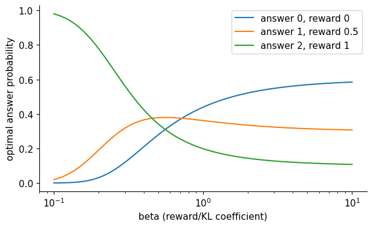
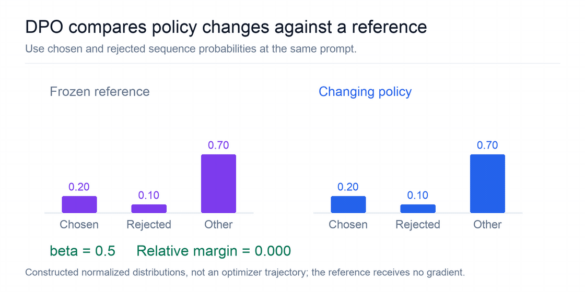
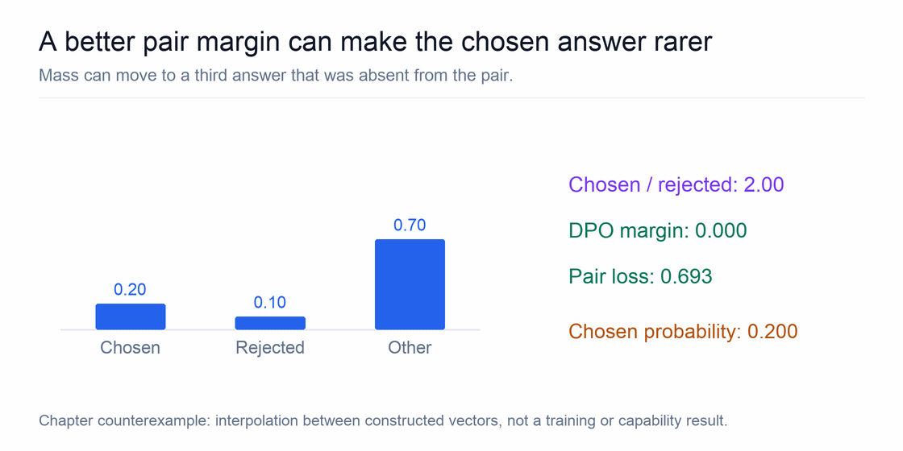
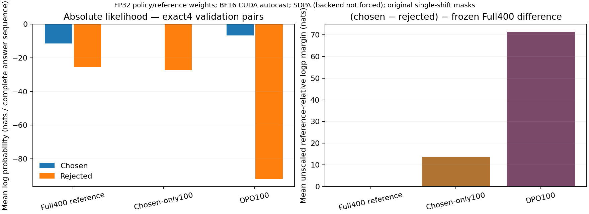

# 11. Direct Preference Optimization

> Our life is frittered away by detail. … Simplicity, simplicity, simplicity!
>
> — Henry David Thoreau, *Walden*

Chapter 10 ended with a frozen reward model and a warning. The obvious next
step is to train a policy against that reward. But that route has many moving
parts. We need the reward model itself, a loop that samples fresh answers from
the policy, scoring for every sample, and a penalty that keeps the policy from
drifting too far. Every one of those parts can fail. And Chapter 10 showed that
a policy pushing hard on a fitted reward will find the places where the reward
is wrong.

Thoreau's advice is to cut away detail until only what matters is left. That is
the spirit of **Direct Preference Optimization (DPO)**: a way to train the
language policy straight from recorded preference pairs, with no separately
fitted reward model and no sampling loop. DPO gets there through a change of
variables. Its simplicity is useful only when we understand what is being
compared, which reference is held fixed, and what the loss does not guarantee.
So the chapter also asks what the simpler recipe hides. We take it in six steps:

1. Write down what we want: high reward, with a penalty for moving away from a
   fixed reference policy (§11.1).
2. Solve that problem exactly when there are only a few possible answers. The
   best policy turns out to be the reference, tilted toward reward (§11.2).
3. Turn the solution around so that reward is written in terms of the policy.
   An awkward normalizing constant cancels, and the DPO loss appears (§11.3).
4. Read the gradient, see what $`\beta`$ means, and meet a counterexample where
   the loss improves while the preferred answer gets less likely (§11.4).
5. Implement it carefully: sequence sums, length and a truly frozen
   reference (§11.5–11.7).
6. Test it in controlled experiments, including one where DPO wins its pairs
   but loses at generation (§11.8).

This chapter builds on sequence likelihood, Bradley–Terry modeling, and
supervised fine-tuning. Days 17 and 18 form one route: derive the objective,
audit its implementation, then compare policies using a frozen evaluation
contract. The complete derivation below is an independently worked finite-space
example of the construction introduced in
[Rafailov and colleagues' DPO paper](https://arxiv.org/abs/2305.18290).
In this course's map of post-training, the chapter completes **preference
alignment**, the second technique after instruction tuning: Chapter 10
learned from judgments through a reward model, and DPO learns from the same
judgments directly.

The interesting puzzle is stronger than “does the chosen answer beat the
rejected one?” Suppose both become less likely and a third answer gains their
probability mass. Could the pairwise loss still improve? Keep this question in
view while deriving the objective: the answer will tell us what DPO measures
and why free-generation evaluation remains necessary.

## 11.1 The reference is a distribution over possible continuations

Before we can skip the reward model, we need to say what a good policy would do
if we had one. "Maximize reward" alone is a bad goal. Chapter 10 showed that a
policy chasing a fitted reward finds its loopholes. So we add a second wish:
don't stray too far from a policy we already trust.

Think of a dog on an elastic leash. It can wander toward something interesting,
but the further it goes, the harder the leash pulls back. The **reference
policy** is the person holding the leash: a fixed model, usually the SFT
checkpoint, that says what "normal behavior" looks like. The number $`\beta`$
sets how stiff the leash is.

Fix prompt $`x`$ and let $`\pi_{\mathrm{ref}}(y\mid x)`$ be a reference policy over
complete responses. It is commonly a supervised checkpoint at the start of
preference training. A policy $`\pi`$ may move probability toward higher-reward
answers, but a movement penalty expresses a preference for staying near that
reference:

```math
J(\pi)=\sum_y\pi(y\mid x)r(x,y)
-\beta\sum_y\pi(y\mid x)\log\frac{\pi(y\mid x)}{\pi_{\mathrm{ref}}(y\mid x)},
\qquad \beta>0.
```

The second term is $`\beta\,\mathrm{KL}(\pi\Vert\pi_{\mathrm{ref}})`$, the
**KL penalty**: a charge for how far the policy's answer distribution has moved
from the reference's. Its direction matters: samples would come from the current policy, and their log
ratio is measured against the reference. The finite derivation assumes the
reference is positive on every candidate under discussion and rewards are
finite. A policy placing mass outside the reference support incurs infinite
forward KL. Real softmax models have positive theoretical token probabilities,
but truncation, top-$`k`$ sampling, and numerical underflow can create a different
effective support. Do not quietly transfer a theorem about one distribution
to another sampler.

Here $`r(x,y)`$ is the fixed reward in the finite derivation. A trained reward
model is written $`r_\phi(x,y)`$ elsewhere; DPO below eliminates the explicit
reward through policy log ratios rather than fitting that model.

This is an objective over response probabilities. It does not mean that two
neural checkpoints have nearby weights, nor that a small KL implies every
rare behavior is preserved. A reference is a behavioral anchor under a specified
prompt population; that population belongs in the experiment contract.

Chapter 3 introduced KL as the mismatch between two distributions. Here its
coordinates are complete responses: the expectation weights a log ratio by
the current policy's probability. Moving mass to an answer that was unlikely
under the reference is costly in this direction. The anchor therefore expresses
which behavioral distribution the reward must justify moving away from.
It is different from the **old policy** used later to account for collected
samples: an old policy can refresh after collection, while this reference
remains fixed throughout the declared preference-training objective.

## 11.2 Solve the finite optimization problem

We have an objective. Which policy maximizes it? For a real language model we
can't search every possible response. But if we pretend there are only a
handful of possible answers, the problem has an exact solution, and its shape
is what makes DPO possible.

The only catch is that probabilities must add up to one. A **Lagrange
multiplier** is the standard tool for that: an extra variable that enforces a
constraint while we take ordinary derivatives. Use a Lagrange multiplier $`\lambda`$ for $`\sum_y\pi_y=1`$:

```math
\mathcal{F}=\sum_y\pi_y r_y
-\beta\sum_y\pi_y\log(\pi_y/\pi_{\mathrm{ref},y})
+\lambda\left(\sum_y\pi_y-1\right).
```

Differentiating with respect to a positive probability gives

```math
r_y-\beta\left(\log\frac{\pi_y}{\pi_{\mathrm{ref},y}}+1\right)+\lambda=0.
```

First isolate the log ratio:

```math
\log\frac{\pi_y}{\pi_{\mathrm{ref},y}}
=\frac{r_y}{\beta}+\frac{\lambda}{\beta}-1.
```

Exponentiating gives
$`\pi_y=C\,\pi_{\mathrm{ref},y}\exp(r_y/\beta)`$, where
$`C=\exp(\lambda/\beta-1)`$ is shared by all responses to this prompt.
The sum-to-one constraint now determines that constant:
$`1=C\sum_y\pi_{\mathrm{ref},y}\exp(r_y/\beta)`$.
Call that sum the **partition function** $`Z(x)`$, the total that turns
unnormalized weights into probabilities; then $`C=1/Z(x)`$.
The multiplier enforces the competition for one unit of probability mass:

```math
\pi^*(y\mid x)=\frac{\pi_{\mathrm{ref}}(y\mid x)\exp(r(x,y)/\beta)}{Z(x)},
\qquad Z(x)=\sum_y\pi_{\mathrm{ref}}(y\mid x)\exp(r(x,y)/\beta).
```

In words: start from the reference's probabilities, multiply each one by
$`\exp(r/\beta)`$, and rescale so they add to one. An **exponential tilt** is
exactly this reweighting. The optimum exponentially tilts the reference toward reward. Compute it as
$`\mathrm{softmax}(\log\pi_{\mathrm{ref}}+r/\beta)`$ for stability. With fixed
reward, large $`\beta`$ resists movement; small $`\beta`$ concentrates mass more
strongly. Adding a prompt-dependent constant to rewards multiplies numerator
and partition function by the same factor, so the policy is unchanged:

```math
\frac{\pi_{\mathrm{ref}}(y\mid x)\,e^{c(x)/\beta}\exp(r(x,y)/\beta)}
{\sum_{y'}\pi_{\mathrm{ref}}(y'\mid x)\,e^{c(x)/\beta}\exp(r(x,y')/\beta)}
=\frac{\pi_{\mathrm{ref}}(y\mid x)\exp(r(x,y)/\beta)}{Z(x)}.
```

This
is Chapter 10's reward gauge appearing inside an optimization problem.

### Three answers make the anchor visible

Use [Day 17's existing categorical fixture](../../notebooks/day-17/01_kl_regularized_optimum.ipynb):
reference $`(0.6,0.3,0.1)`$, rewards $`(0,0.5,1)`$ and $`\beta=0.5`$.
The computation is a reward-weighted reallocation of a fixed total:

| Complete answer | Reference probability | Reward | Reference × exponential tilt | Normalized optimum |
|---|---:|---:|---:|---:|
| 0 |0.6|0|0.600000|0.278501|
| 1 |0.3|0.5|0.815485|0.378522|
| 2 |0.1|1|0.738906|0.342977|

The unnormalized weights sum to $`Z=2.154390`$. Dividing by that same number
preserves their ratios and makes their probabilities sum to one. Answer 2 has
the largest reward but still less mass than answer 1: its smaller reference
probability matters. This is precisely what anchoring adds to reward seeking.

**Controlled change:** double $`\beta`$ to one, holding the reward and reference
fixed. Predict whether the high-reward answer gains more mass.

**Reference reasoning:** the tilt becomes weaker; the optimum is now
$`(0.439096,0.361973,0.198931)`$, closer to the reference. The existing
[`optimal_policy` helper](../../src/dongxi_llms/dpo_lab.py) computes both
cases as `softmax(reference.log() + reward / beta)`. Adding fifty to all
rewards instead leaves the normalized result unchanged because the shared
factor cancels. The notebook checks that cancellation and the constant
stationarity derivative directly.



Follow each answer's curve as beta changes; the horizontal axis is logarithmic.
The middle-reward answer can first gain and then lose mass because both the
reference and the competing highest-reward answer matter. This is an exact
finite optimization plot generated by the notebook's beta sweep, not a neural
training trajectory. Its beta comparison holds reward fixed; the DPO gradient
comparison in §11.4 holds a preference example fixed.

The solution is exact for unrestricted finite distributions. A transformer
shares parameters across prompts and may not represent every independently
specified optimum. Optimization, preference coverage, and finite sample noise
are further limitations. The closed form is the reason for the loss design,
not a certificate that a short neural training run reaches the ideal policy.

## 11.3 Replace the latent reward with policy log ratios

Section 11.2 went from a reward to a policy. Now run that arrow backwards. If
we know how the best policy differs from the reference, we can read off the
reward that must have caused the difference. It's like a cook who started
from an old recipe book: compare what the cook now makes with what the book
suggested, and the dishes made more often than before tell you what the diners
liked. The one obstacle is $`Z(x)`$, a sum over every possible response,
which we could never compute for real text. The trick is that we never need it.

Take logarithms of the optimum:

```math
\log\pi^*(y\mid x)=\log\pi_{\mathrm{ref}}(y\mid x)+\frac{r(x,y)}{\beta}-\log Z(x).
```

Multiply by $`\beta`$ and solve for the reward:

```math
r(x,y)=\beta\log\frac{\pi^*(y\mid x)}{\pi_{\mathrm{ref}}(y\mid x)}
+\beta\log Z(x).
```

For two responses to the same prompt, the $`\log Z(x)`$ terms cancel. Subtract
the loser's reward from the winner's:

```math
r(x,y_w)-r(x,y_l)
=\beta\log\frac{\pi^*(y_w\mid x)}{\pi_{\mathrm{ref}}(y_w\mid x)}
-\beta\log\frac{\pi^*(y_l\mid x)}{\pi_{\mathrm{ref}}(y_l\mid x)}.
```

Bradley–Terry only ever uses this difference, so the unknowable $`Z(x)`$ is gone.
Now put the trainable policy $`\pi_\theta`$ where $`\pi^*`$ was. Each term
$`\beta\log(\pi_\theta/\pi_{\mathrm{ref}})`$ plays the role of a reward; call it
the **implicit reward**, the reward that the policy's own movement implies.
Define the policy's reference-relative pair margin

```math
m_\theta=\beta\left[
\log\pi_\theta(y_w\mid x)-\log\pi_{\mathrm{ref}}(y_w\mid x)
-\log\pi_\theta(y_l\mid x)+\log\pi_{\mathrm{ref}}(y_l\mid x)
\right].
```

Substitute this into the Bradley–Terry preference likelihood. The model's
probability that the recorded winner wins, and its negative log, are

```math
P_\theta(y_w\succ y_l\mid x)=\sigma(m_\theta),\qquad
-\log\sigma(m_\theta)=\log\left(1+e^{-m_\theta}\right).
```

For an ordered winning pair, that negative log-likelihood is the DPO loss:

```math
L_{\text{DPO}}=\mathrm{softplus}(-m_\theta).
```

For an explicit soft preference target $`q`$, use
$`\mathrm{softplus}(m_\theta)-q m_\theta`$. The model is now a language policy,
but the classification target is still a preference. Offline DPO needs the
recorded pair's likelihoods; it does not require generating a fresh response
for every update. That operational advantage does not remove biases inherited
from the recorded comparisons.

The reference-relative term asks “How has the policy changed the relative odds
since initialization?” It does not simply ask whether the chosen completion
is more probable than the rejected completion. An answer initially unlikely
under the reference can receive a favorable implicit reward after a modest
probability increase while still remaining unlikely in absolute terms.

This explains the computational shortcut. For each recorded pair, score the
chosen and rejected complete responses under the trainable policy and fixed
reference. Their four log probabilities supply a classification margin; no
separately fitted reward model or fresh policy rollout is needed for that
update. The eliminated object is the explicit reward model, rather than the
judgment process. DPO still learns from the rubric, noise and coverage of the
recorded comparisons. A reward-model-plus-policy route can score newly sampled
responses, but adds the problem of reward extrapolation developed in Chapter 10.


<!-- chapter-gif: dpo-reference -->
**Predict:** Which terms stay fixed when the policy changes?



*Chosen and rejected probabilities are compared against a frozen reference. These normalized vectors illustrate the relative margin rather than a training trajectory.*

[Try the notebook](../../notebooks/day-17/01_kl_regularized_optimum.ipynb) · [View a still image](../../visuals/chapters/rendered/dpo-reference.png)
<!-- /chapter-gif: dpo-reference -->

## 11.4 The gradient and the meaning of beta

We have a loss. What does it push the policy to do, and how hard? As in
Chapter 10, the gradient is short enough to read by eye. It also clears up a
puzzle about $`\beta`$, which seems to mean "move less" in one place and "move
more" in another.

Write $`c=\log\pi_\theta(y_w\mid x)`$ and
$`l=\log\pi_\theta(y_l\mid x)`$. With the soft-target loss
$`L=\mathrm{softplus}(m_\theta)-q m_\theta`$ from §11.3, the chain rule needs
three pieces. The reference terms in $`m_\theta`$ are constants:

```math
\frac{\partial L}{\partial m_\theta}=\sigma(m_\theta)-q,\qquad
\frac{\partial m_\theta}{\partial c}=\beta,\qquad
\frac{\partial m_\theta}{\partial l}=-\beta.
```

Multiply them together. With a frozen reference,

```math
\frac{\partial L}{\partial c}=\beta(\sigma(m_\theta)-q),\qquad
\frac{\partial L}{\partial l}=-\beta(\sigma(m_\theta)-q).
```

At initialization $`\pi_\theta=\pi_{\mathrm{ref}}`$, every relative margin is
zero. For a hard winning pair the derivatives are $`-\beta/2`$ and $`\beta/2`$.
At this point larger $`\beta`$ gives a larger local gradient for fixed learning
rate. Yet in the fixed-reward optimum larger $`\beta`$ means stronger restraint.
These statements concern different comparisons and are compatible.

For a fixed noisy target $`q`$, the optimal classifier margin is
$`m^*=\log(q/(1-q))`$. The corresponding change in pair log odds is $`m^*/\beta`$.
Thus changing beta alters both gradient scale and the policy displacement
needed to fit the same preference probability. Report beta with learning rate,
update count, and data noise. It is not inference temperature: sampling
temperature modifies decoding after training, while beta defines the training
objective relative to a reference.

The full parameter gradient combines both answer branches through shared
transformer weights. Just as in Chapter 10, independent scalar derivatives do
not imply independent changes in every sequence probability. DPO can increase
the pair ratio while decreasing *both* answers' absolute likelihoods. Probability
mass can move toward a third continuation absent from the comparison.

### A better pair can be a worse source of the chosen answer

Return to the opening puzzle using the normalized distributions from worked
exercise 5. Freeze the first distribution as the reference and set $`\beta=0.5`$:

| Constructed policy | Chosen probability | Rejected probability | Third-answer probability | Chosen/rejected odds | DPO margin | Hard-pair loss |
|---|---:|---:|---:|---:|---:|---:|
| Initial/reference |0.20|0.10|0.70|2|0|0.693147|
| Changed |0.10|0.01|0.89|10|0.804719|0.369640|

The relative odds improve fivefold, giving margin $`0.5\log(10/2)=0.804719`$.
The chosen answer is now only half as likely, yet the pair loss is lower.
The rejected answer lost proportionally more mass. These are deliberately
constructed probability vectors, not a claimed optimizer path or a new model
result. They show that the loss itself cannot exclude this behavior.

**Reader prediction:** hold the third answer's mass fixed instead. Could the
chosen answer decrease while its odds over the rejected answer increase?

**Reference reasoning:** with their combined mass fixed, increasing the chosen
share relative to the rejected one must increase its absolute probability.
The extra available outcomes make the counterexample possible. A language
model has many such outcomes, and one parameter can influence both compared
responses and their alternatives. The local score derivatives above give
the loss's pressures; their composition with the network determines movement.

A frozen reference supplies a fixed origin for the log-odds change. It does
not put an upper bound on the fitted margin: a hard separable pair can approach
zero rejected probability and an arbitrarily large log-odds ratio. Response
probabilities remain bounded between zero and one. The KL-regularized finite
reward optimum motivated the parameterization, but fitting noisy or incomplete
pair data is not a per-step guarantee of that optimum's restraint.


<!-- chapter-gif: dpo-counterexample -->
**Predict:** Why is the third continuation necessary for this counterexample?



*The chapter's constructed distributions improve pair odds while halving chosen probability. Motion interpolates the two vectors; it does not depict an observed optimizer path.*

[Try the notebook](../../notebooks/day-18/02_dpo_retention_and_preference_controls.ipynb) · [View a still image](../../visuals/chapters/rendered/dpo-counterexample.png)
<!-- /chapter-gif: dpo-counterexample -->

## 11.5 Sequence likelihood is a sum with a boundary

The derivation so far treated each response as one indivisible answer with one
probability. A language model doesn't hand us that number. It gives one
probability per token, and we must add up the right tokens. Which tokens count
as "the response" turns out to be an easy place to make a silent mistake.

An autoregressive completion has

```math
\log\pi_\theta(y\mid x)
=\sum_{t=1}^{|y|}\log\pi_\theta(y_t\mid x,y_{\lt t}).
```

Include a termination token under the declared template when it belongs to the
response. Otherwise a model can assign high prefix likelihood without learning
when to stop. Do not sum prompt likelihood into the DPO response score. The
prompt supplies context and can receive gradients through attention, but its
tokens are not the completion being compared.

For a batch, predictive logits have shape $`[B,n,V]`$, aligned labels and the
completion mask have shape $`[B,n]`$, and the gathered token log-probabilities
have shape $`[B,n]`$. Summing the masked values produces $`[B]`$ sequence scores.
Chosen and rejected branches each produce one vector. The DPO loss reduces the
pair vector only after these sums.

Perform causal shifting exactly once: run the model on `input_ids[:, :-1]`,
score `input_ids[:, 1:]`, and shift the completion mask with the target tokens.
The first response token is predicted at the final prompt position. A mask
shifted by the input positions instead of target positions drops that token and
may accidentally score another boundary. Padding masks affect attention;
completion masks affect which targets enter the score. They have different jobs.

Use `log_softmax`, gather safe labels, then mask. Labels set to `-100` cannot
be gathered directly; replace unscored labels by a valid temporary index before
gathering. Reject an empty scored completion instead of quietly assigning zero
likelihood. Every branch must use the same tokenizer, template, EOS convention,
precision policy, and response boundary for policy and reference.

## 11.6 Length normalization changes the model

A sum over tokens has an obvious side effect: longer answers collect more
negative terms. It's tempting to "fix" this by dividing by length. Before doing
that, ask what the division does to the objective we derived.

Long sequences often have more negative log-probability because they contain
more terms. Summing is nevertheless the log-likelihood of the full response.
Dividing by response length is called **length normalization**. It gives average token log-probability, which describes
a different comparison. Replacing sums by averages in the standard derivation
does not preserve its response distribution interpretation.

This does not mean every length-adjusted preference algorithm is invalid; it
means an adjustment requires a named objective and a separate argument. First
audit preference length differences, EOS handling, truncation, and the generation
length distribution. Compare independent quality slices at matched length as
well as ordinary prompts. Do not declare a loss-mask or sequence-sum bug to be
“length debiasing.” The Day 17 heatmap lab exposes prompt, response, and pad
positions so that this boundary is visible.

## 11.7 A frozen reference is an implementation contract

Every DPO margin is measured against the reference, so the reference is the
ruler. If the ruler shifts during training, the margins stop meaning what the
derivation says. "Frozen" sounds simple, but there are several ways to freeze a
model only partly.

Put the reference in evaluation mode, disable gradients, and score it under
`no_grad`. Do not update it with the policy optimizer. Disabling dropout matters:
otherwise two identical checkpoints can produce different log-probabilities at
initialization because of stochastic layers. Freezing weights alone is not
evaluation mode, and evaluation mode alone is not freezing gradients.

Reference scores may be cached for a fixed dataset. The cache identity must
include checkpoint hashes, tokenized sequence hashes, template and tokenizer
revisions, completion boundaries, dtype, and any normalization convention.
Changing any of these invalidates the cache. A detached tensor from the current
policy is not a fixed reference: it prevents one backward path but changes every
step, producing a different objective.

Reference memory is a real cost: the transparent full-weight path holds a
policy, the original frozen reference and one policy optimizer. A cached-score
or adapter-based implementation can reduce that cost only after checking that
it preserves the response scores and reference identity.

Recovery has the same objective boundary. Copying the restored trained policy
into the reference changes every reference-relative margin. Retain the original
reference, optimizer, pair sampler and RNG together with the policy. Restoring
only weights may produce valid tensors while changing the experiment. Failed
attempts also remain spent work even when numerical state is rolled back.
[Appendix D](../appendices/d-reproduction-and-environments.md#policy-reference-and-pending-rollout-identity)
separates this principle from snapshot, journal and supervision mechanics.

## 11.8 Controlled experiments and an instructive negative result

We now have a derived loss and a careful implementation. Does lowering the
loss actually give a better policy? The counterexample in §11.4 says it need
not, at least in principle. This section tests that worry with real training
runs, from tiny CPU models up to a pretrained pilot.

Two CPU experiments answer different questions. The categorical experiment has
two contexts and three possible complete answers. It uses known soft preferences
and compares DPO, flipped-label DPO, and chosen-only SFT from the same reference.
Exact expected reward and reference KL are available because the entire response
space can be enumerated. An oracle exponential tilt is an analysis benchmark,
not an extra training label secretly supplied to DPO.

The sequence experiment trains the actual tiny decoder from Chapter 5. Six
short prompts prefer an answer token called A over B; both branches include
EOS. A held-out prompt measures $`P(A\mid x_{\text{heldout}})`$ independently of
the pair loss. It is intentionally a severe simplification: answers are symbolic,
the prompt set is tiny, and no English capability is being tested.

The point to take from these runs: a lower pair loss is not, by itself,
evidence of a better answer.
The [report](../../experiments/reports/2026-10-04-preference-policy-cpu.md)
retains the resulting curves, including failures. A favorable pair margin can
coexist with worse absolute probability of the desired answer. That is a concrete
reason to evaluate free generation and independent tasks after preference
training. The chosen-SFT arm provides a useful control, but it sees demonstration
supervision rather than identical information; equal update count does not make
the two datasets semantically equivalent.

For a pretrained comparison, preserve the SFT parent, include an untouched
parent and a chosen-only control, and freeze independent generation panels.
Match actual draws, not merely seeds. Section 11.8.4 reports the executed
100-update comparison; the CPU controls above remain evidence about a different
model and response space. The [lab route](../labs/11-direct-preference-optimization.md)
lets you inspect both without treating a larger pair margin as the final verdict.

### 11.8.1 Chosen likelihood and rehearsal: extra objectives, not free repairs

If DPO can make the preferred answer less likely, why not add a term that
pushes it up directly? And if training on preferences can erode other skills,
why not keep practicing those skills on the side? Both ideas are common. Both
also change what is being optimized, so we should look at them as new
objectives, not as bug fixes.

A preference comparison says which of two recorded responses should win. It
does not supervise every other response or every other task. To give an absolute
chosen-likelihood objective a voice, augment the pair loss explicitly. The
**chosen NLL** term is ordinary next-token loss on the preferred answer, and
**rehearsal** is supervised practice on retained demonstrations, such as
examples of a skill we want to keep:

```math
L_{\lambda_{\mathrm{SFT}},\gamma}=L_{\text{DPO}}
+\lambda_{\mathrm{SFT}} N_{\text{chosen}}+\gamma N_{\text{rehearsal}},\qquad
N_{\text{chosen}}=-\frac{\sum_{i=1}^B c_i}{\sum_{i=1}^B n_{w,i}}.
```

Here $`c_i`$ is the summed chosen-response log-likelihood, $`n_{w,i}`$ counts
its valid response tokens including EOS, and $`B`$ is the number of pairs.
$`N_{\text{rehearsal}}`$ is a separate supervised next-token loss on retained
demonstrations, also normalized by its own valid-token count. $`\lambda_{\mathrm{SFT}}`$ and $`\gamma`$
are nonnegative coefficients. This global token mean is not a mean of
per-response averages; variable response lengths make the distinction matter.
Neither auxiliary changes the DPO response sums into token averages. The
companion API names the chosen-NLL coefficient `alpha`; here it is written
$`\lambda_{\mathrm{SFT}}`$ to distinguish it from other objective weights.

With hard recorded preferences and frozen references, the direct chosen-score
derivative is

```math
\frac{\partial L_{\lambda_{\mathrm{SFT}},\gamma}}{\partial c_i}
=\frac{\beta}{B}(\sigma(m_i)-1)
-\frac{\lambda_{\mathrm{SFT}}}{\sum_j n_{w,j}}.
```

The extra negative term pushes recorded chosen likelihood upward. Rehearsal
adds its own parameter gradient; it is not a new direct derivative of this
pair's score. Through shared embeddings, attention and MLP weights, those
directions can reinforce or compete. Setting $`\lambda_{\mathrm{SFT}}=0`$ recovers ordinary DPO
**only when $`\gamma`$ is also zero**. A positive rehearsal coefficient still
defines a different objective.

This added pressure is not a correctness guarantee. If the recorded winner is
wrong, chosen NLL imitates the wrong response. If it is unnecessarily verbose,
the auxiliary teaches that style too. Rehearsal protects only the supplied
distribution under its weight and budget; it neither bounds every forgotten
capability nor ensures transfer to new inputs. These terms change supervision,
not just numerical stability.

The next experiment asks whether these extra terms protect a second skill
while DPO trains on the first.
The [retention and preference-control notebook](../../notebooks/day-18/02_dpo_retention_and_preference_controls.ipynb)
uses the actual shared decoder and supervised stack, rather than another
independent logit table. A frozen recipe jointly warms the model on symbolic
first-slot copying and a separate parity task, then copies that warm state
into DPO, DPO+chosen NLL, DPO+rehearsal and the combined arm. All three seeds,
fixed coefficients, final checkpoints and four data conditions are retained:
clean pairs, fixed label swaps, longer chosen responses, and matched-length
long responses. The parity pairs never enter preference training, while their
training demonstrations supply rehearsal. Common boundary tokens are shared;
the operands and answer alphabets otherwise differ.

The evaluation asks two different questions: can the policy preserve the
trained parity skill, and can it freely generate the right first-slot response
for unseen ordered pairs? It consumes its own emitted tokens, not a gold
continuation, and records EOS, truncation and full canonical completion.
First-answer correctness is weaker than answer-plus-EOS success. The symbolic
parity held-out uses previously unseen numeral tokens, so it is a severe input
novelty slice rather than isolated arithmetic extrapolation. No held-out row
chooses a coefficient, warm checkpoint or favorable seed.

Inspect absolute chosen and rejected sequence log-likelihood alongside margin;
then inspect generated rows and the separate-task slice. The
[predeclared protocol](../../experiments/specs/2026-10-04-dpo-retention.md) and
[retained evidence](../../experiments/reports/2026-10-04-dpo-retention.md)
disclose pair tokens, chosen auxiliary supervision and additional rehearsal
forwards. Chosen NLL reuses the chosen scores: it adds an objective but not a
new chosen forward. Rehearsal adds different targets and another forward.
Equal update counts are consequently neither equal information nor equal
processing budgets. This new comparison does not replace or relabel the
earlier negative DPO result and establishes no universal repair or Qwen claim.

In brief: rehearsal helped the parity skill, chosen NLL did not, and nothing
fixed held-out copying.
The fixed experiment also retains failures in the warm control: all three
warm states solve their four training copying prompts, none solves an unseen
copying pair, and parity succeeds on only 3/4, 2/4 and 2/4 trained rows.
Under clean DPO those parity scores become 2/4, 0/4 and 2/4. Chosen NLL keeps
absolute chosen likelihood high here but does not protect parity; rehearsal
arms reach 4/4, 3/4 and 4/4 parity successes. Because parity was not fully
learned initially, this last change includes further supervised learning, not
only protection of an already perfect capability. Held-out copying stays low,
and fixed noisy-label controls fail it entirely. These observations are useful
precisely because the added objectives do not repair every failure.

### 11.8.2 What a matched chosen-SFT control actually matches

Suppose DPO improves the location task. Did the comparison teach a useful
distinction, or would simply showing the preferred answer again have helped?
An untouched-parent arm and a chosen-only SFT arm make that question testable.
They do not make the supervision identical: chosen-SFT never sees the rejected
answer, while DPO evaluates both responses against the original frozen reference.

The [paired-path implementation](../../src/dongxi_llms/chosen_sft_control.py)
uses the existing preference runner's encoding, collator and DPO update, and
the existing SFT runner's summed cross-entropy. It converts the exact chosen
response mask into SFT labels, retaining prompt masking, one shift and the
terminal target. All arms start from the same independently identified parent;
the trainable arms use the same private with-replacement draws. Equal seed
numbers alone would not establish that equality if one runner instead shuffled
through a cyclic data stream.

Chosen-SFT divides the accumulation window's summed cross-entropies by its
total valid chosen targets. DPO uses complete-response log-probability sums
inside a mean-pair loss. These are explicit objective reductions, not interchangeable
uses of a common learning rate. A longer preferred response therefore contributes
through all its valid targets; it is not silently reduced to one equally weighted
per-response token average.

Report what is matched: parent, actual draw indices, chosen IDs/masks, valid
chosen targets, updates and declared optimizer recipe. Then report what is not:
rejected supervision, policy input geometry, reference calls, reduction and
compute. Equal chosen exposure is a useful control for demonstration repetition;
it is not an equal-information or equal-FLOP experiment.

The small run below checks that the matching machinery works. It is not a
test of answer quality, and no arm answers correctly.
The [two-seed CPU report](../../experiments/reports/2026-10-05-matched-chosen-sft-control.md)
uses saved and reloaded random 6,592-parameter parents, not pretrained weights.
Each trained arm makes 12 identical pair draws and sees 48 chosen targets.
Chosen-SFT submits 12 policy forwards over 288 input positions, with no reference
forwards. DPO additionally supervises 36 rejected targets and submits 24 policy
and 24 reference forwards, over 540 positions in each lane. These training
counters exclude the separate validation/generation work; they are not FLOPs.

All six fixed arm/seed rows receive 0/4 independent exact match. Both chosen-SFT
rows stop naturally on all four prompts, while DPO stops on four and one.
Emitting EOS is not answering correctly. The report retains the actual wrong
texts and caps; no arm, coefficient or checkpoint is chosen to conceal this
failure. The successful matching and mask checks establish an instrument, not
a useful location assistant or a prediction of the pretrained outcome.

The original location fixtures keep training, validation and publication
scenarios separate. The held-out generation consumes its own emitted tokens
and is graded against independently authored answers after generation. Keep
raw failures, EOS versus caps and absolute chosen/rejected likelihoods; neither
the final arm nor its hyperparameters are selected from those held-out scores.
The [lab](../labs/11-direct-preference-optimization.md) links the runnable
matching microscope. Its pretrained counterpart is the separately measured
comparison in section 11.8.4; random-model correctness checks do not substitute
for those actual outputs.

### 11.8.3 Recovery must preserve what the comparison matched

Long runs crash, and we restart them from saved state. Section 11.7 showed that
restoring only the weights can quietly change a DPO experiment. A matched
comparison adds another risk: the two arms may need different things restored
to stay matched.

A chosen-only control and DPO can share draws while requiring different
restart checks. Chosen-only needs its chosen-token objective and replacement
sampler; DPO additionally needs rejected scores and its original reference.
Restoring a shuffled cyclic sampler instead of the declared replacement sampler
changes future exposure. A failed attempt remains part of the physical cost,
although its partial numerical state must not become a completed checkpoint.

[CPU chosen-control replay](../../experiments/reports/2026-10-05-chosen-sft-accounted-recovery.md),
[native chosen-control replay](../../experiments/reports/2026-10-05-native-chosen-replay.md)
and [native DPO replay](../../experiments/reports/native-dpo-replay-20261005-run-03/acceptance.json)
provide distinct evidence for these boundaries. Their technical success says
nothing by itself about location answers. The snapshot and supervision details
are collected in [Appendix D](../appendices/d-reproduction-and-environments.md#supervision-and-durable-evidence).

### 11.8.4 The preferred answer can win a pair without winning generation

Consider two different questions. In a preference pair, does the policy favor
the recorded chosen answer over its recorded alternative, relative to the
reference? In free generation, does the policy actually emit the required
answer? DPO directly trains the first question. A common independent generation
panel is needed for the second.

### Reader prediction

Before revealing the comparison, suppose DPO greatly increases its validation
chosen/rejected margin. Must it emit more exact location answers than chosen-only
SFT? Write a prediction for absolute chosen likelihood, exact answer content and
natural stopping separately. This is a reader exercise; it is not a claim about
the historical pre-run hypothesis.

### Comparison settings

| Control | Declared comparison |
|---|---|
| Parent | Same original full400 SFT export; recovery weights are not pilot parents |
| Exposure | 100 updates; identical 400 replacement draws and 2,047 chosen targets |
| Chosen-only objective | Global valid-chosen-token NLL |
| DPO objective | Mean pair loss using complete-response sums, original reference and $`\beta=0.1`$ |
| Common generation | Saved template, greedy decoding, 64-token cap; BF16-loaded policies |
| Pair scoring | FP32 weights with BF16 autocast; four separate validation pairs |

Here is what the pilots show, in one sentence: DPO opens a far larger
preference margin, yet chosen-only SFT gives more exact location answers.
The [actual Spark pilots](../../experiments/reports/2026-10-05-native-preference-comparison.md)
make this distinction concrete. Both begin afresh from the original full400 SFT
export after their separate native recovery gates pass. Both make 100 updates
using the same 400 replacement draws and 2,047 chosen targets. Chosen-only uses
global chosen-token NLL; DPO uses complete-response log-probability sums,
mean-pair loss, beta 0.1, rejected answers and the original frozen reference.
The parent, actual draws, IDs and response masks are matched, not simply their
seed numbers. Neither recovery's trained weights initializes its pilot.

| Training work, excluding validation and generation | Chosen-only 100 | DPO100 |
| --- | ---: | ---: |
| Chosen targets |2,047|2,047|
| Rejected targets |0|1,600|
| Policy forwards |400|800|
| Policy positions |13,343|25,439|
| Reference forwards |0|800|
| Reference positions |0|25,439|

Equal chosen exposure is not equal information or compute. Chosen-only
processes full chosen inputs, whereas the DPO path uses its single-shift
chosen/rejected scoring geometry. Validation reference calls in the chosen-only
observer are separate diagnostics, not a hidden reference training objective.
Counts describe processed operations, not FLOPs. Native elapsed time also
includes saving, validation, generation and integrity work; differing observer
paths prevent interpreting its ratio as a universal algorithmic speed comparison.

The two pilots completed their fixed training boundaries. Their own-run
location diagnostics use FP32-loaded weights with BF16 autocast; the common
comparison below uses BF16-loaded generation. Both diagnostic baselines give
0/4 exact location answers and 4/4 natural stops. After training, chosen-only
gets 4/4 exact answers and DPO 1/4, with natural stopping on all four prompts.
Agreement across the two loading paths was measured; it is not assumed.

### Read the emitted answer

The following are the first three location items in the fixed common panel,
not examples selected for a favorable outcome. Complete DPO scoring text is
retained; the third output's trailing newline is shown explicitly. All three
responses stop naturally. The [common comparison report](../../experiments/reports/2026-10-05-native-preference-comparison.md#separate-generated-answer-and-retention-populations)
retains their exact-match contract and output provenance.

| Prompt fact and question | Required whole answer | DPO emitted scoring text |
|---|---|---|
| Inez put the ring in the purple pouch. Where is the ring? | `the purple pouch` | `purple pouch` |
| Jun left the brush in the tall vase. Where is the brush? | `the tall vase` | `the tall vase` |
| Elin placed the ticket in the green folder. Where is the ticket? | `the green folder` | `green\n` |

Each full prompt begins `Answer with the location only.` Missing an article and
missing a noun are distinct errors. A strict nonmatch need not mean that every
semantic location is wrong; the frozen whole-answer rule still counts the
response as a nonmatch. Qualitative inspection supplements that rule rather
than replacing it after seeing the outputs.

Why can the four validation margins improve without perfect answers? A relative
chosen/rejected margin constrains two recorded sequence likelihoods against a
reference. It neither constrains every other possible continuation nor requires
each chosen token to be the greedy winner at each generated prefix. A sequence
can improve its relative odds while an alternative token still wins the first
decoding decision. Once generation takes that alternative, later predictions
condition on a different prefix. Exact stopping is another separate property.

The completed common evaluation now checks the unchanged parent, chosen 100
and DPO100 on four validation pairs, four location prompts, 120 instruction
items and 20 annotated reasoning items. Pair scoring uses FP32 weights/BF16 autocast;
generation uses BF16-loaded policies and the same saved-template greedy 64
contract. These code-path labels are not instrumented kernel traces.

The likelihood numbers show both methods raising the preferred answer's
probability, with DPO also pushing the rejected answers down much harder.
In the four-pair likelihood panel, mean chosen logp changes from −11.486888
to −0.003524 for chosen-only and −6.642914 for DPO. Both improve absolute
chosen likelihood here; this native case is not the earlier CPU example of
falling chosen likelihood. DPO also strongly suppresses the rejected answers:
its mean unscaled reference-relative margin is 71.370116 nats versus 13.488587
for chosen-only. Multiplication by beta 0.1 gives the loss's scaled margin.



The generation table shows the same split in delivered text. Neither method
loses ground on the instruction or reasoning panel.

| Independent common generation | Unchanged full400 | Chosen-only 100 | DPO100 |
| --- | ---: | ---: | ---: |
| Strict location answers |0/4|4/4|1/4|
| Original instruction answers |120/120|120/120|120/120|
| Annotated reasoning, bounded-parser correct |5/20|6/20|6/20|

All these responses stop naturally; none hits the output cap. The own-run and
common location counts agree, but that agreement had to be measured across
their distinct loading paths. Neither intervention loses a correct instruction
or reasoning item in these panels. Both retain the same five correct reasoning
IDs and add only `math-10`. Nine seen/development items remain 5/9; the eleven
controlled held-out items change 0/11→1/11. A parser score and this narrow
retention panel do not establish mathematical-step validity, faithful reasoning
or broad assistant competence. Known overlap stays annotated.

The four validation likelihood pairs and four independent location prompts
are different populations. Their aggregate comparison is not a same-prompt
causal diagnosis of an omitted article or noun. Tracing a particular decoding
failure would require its own prefix-level evidence. The nine diagnostic math
rows label eight original fixture-development items plus an additional known
RLVR-overlap item, not math examples used in these assistant policies' training.

Read the source-bound report for raw answers, source-group uncertainty and
separate likelihood/generation work. The plotted observations come from retained records; the figure is not another
training or generation experiment.
Keep margins, absolute likelihoods, exact answers, stopping, retention and
costs in their own lanes. One recipe and four location prompts cannot establish
that either training method is universally superior.

### A preference margin and a delivered answer

The common post-training comparison retains the chapter's chosen-SFT control. A pairwise objective changes relative likelihood; supervised learning on the chosen response changes its likelihood directly. Even when both improve a chosen-versus-rejected margin, their absolute chosen likelihood, ending behavior and generated text can diverge. Assignment E uses the existing paired native and microscopic evidence to examine those quantities together.

A compatible interface is necessary before comparing checkpoints, but it does not match every budget. Count labeled response targets, optimizer updates and generation work separately. For a policy arm, include unsuccessful collected responses and discarded groups. For a chosen-SFT arm, include the supervision used to choose and train on an accepted answer. Neither an equal update count nor an equal retained-token count implies equal collection cost.

The [integration notebook](../../notebooks/extensions/cs336/07_posttraining_integration.ipynb) adds a supervised-parent genealogy and two explicitly named sibling interventions. Its reward branch is a symbolic control; it does not replace the chapter's DPO experiment. Combine their lessons by defending the claim with delivered behavior and independent evaluation, rather than a margin alone.

## Chapter summary

- DPO trains the policy directly from recorded preference pairs. It needs no
  separately fitted reward model and no fresh sampling for each update, but it
  still inherits the rubric, noise and coverage of the recorded comparisons
  (§11.1, §11.3).
- The starting objective is expected reward minus a **KL penalty** that keeps
  the policy near a fixed **reference policy**. Reference and old policy play
  different roles (§11.1).
- In a finite space the optimum is an **exponential tilt** of the reference,
  $`\pi^*\propto\pi_{\mathrm{ref}}\exp(r/\beta)`$. Adding a per-prompt constant
  to rewards changes nothing, which is Chapter 10's gauge again (§11.2).
- Inverting the optimum writes reward as $`\beta`$ times a policy log ratio plus
  $`\beta\log Z(x)`$. The partition function cancels in a within-prompt pair,
  and Bradley–Terry turns the remaining margin into the DPO loss (§11.3).
- The gradient is $`\beta`$ times probability minus target. Larger $`\beta`$
  means a larger initial gradient but a smaller policy move to fit the same
  preference. The pair loss can improve while both compared answers lose
  probability to a third (§11.4).
- Score complete responses as masked token sums with EOS and one causal shift.
  Averaging over length defines a different objective. The reference must stay
  frozen, in evaluation mode and unchanged across restarts (§11.5–11.7).
- In the controlled and pretrained comparisons, a larger margin did not mean
  more exact answers. Extra objectives such as chosen NLL and rehearsal change
  the supervision and are not free repairs. Judge DPO by delivered behavior on
  an independent evaluation (§11.8).

## 11.9 Companion route and exercises

Study [the finite optimum](../../notebooks/day-17/01_kl_regularized_optimum.ipynb),
[the sequence boundary audit](../../notebooks/day-17/02_sequence_likelihood_and_masks.ipynb),
then [the controlled DPO comparison](../../notebooks/day-18/01_dpo_controlled_comparison.ipynb)
and [retention/preference controls](../../notebooks/day-18/02_dpo_retention_and_preference_controls.ipynb).
[Worked answers](../solutions/11-direct-preference-optimization.md) explain the
following questions; each notebook also contains adjacent runnable solutions.

1. Derive the exponential-tilt optimum and state its support assumptions.
2. Why does the partition function disappear from a within-prompt preference?
3. Derive the chosen/rejected log-probability gradients with a soft target.
4. Reconcile larger initial gradients at larger beta with stronger fixed-reward restraint.
5. Why can both chosen and rejected likelihoods fall while the DPO margin improves?
6. Draw the single-shift alignment for prompt, first answer token, EOS, and padding.
7. Why is average token log-probability a different objective from sequence likelihood?
8. What invalidates a reference-log-probability cache?
9. Design a DPO/SFT/control comparison and explain unequal information versus unequal compute.
10. If held-out preference accuracy rises but generation correctness falls, what conclusions and next checks are justified?
11. Derive the chosen-NLL contribution to the chosen-score gradient. Why does $`\lambda_{\mathrm{SFT}}=0`$ not remove a nonzero rehearsal term?
12. Can chosen NLL correct a noisy recorded winner or guarantee parity retention? Explain the supervision and shared-parameter boundaries.
13. Why compare longer-chosen and matched-long pairs, absolute likelihoods, free generation and extra token costs together?
14. Why is copying the resumed policy into a new DPO reference an objective change, even when tensor shapes and tokenizer identities agree?
15. Two arms use the same seed and update count. One cycles through shuffled pairs; the other samples with replacement. Why is chosen exposure not necessarily matched, and what must be compared before making that claim?
16. A chosen-only control restores update 2 after a failed update 3 attempt, then completes six updates. Why can its journal still show seven reserved windows, and why must it not inherit a DPO-specific recovery validator?
17. Two native pilots see exactly 2,047 chosen targets. DPO improves all four validation margins but produces fewer strict whole answers. Why are those observations compatible, what is actually matched, and what does the completed common evaluation establish—and leave unproved?

DPO made preference learning a supervised likelihood problem over log ratios.
Chapter 12 returns to explicit sampled rewards. Its central difficulty is then
estimating how expected reward changes when the policy itself changes the
responses it generates.
