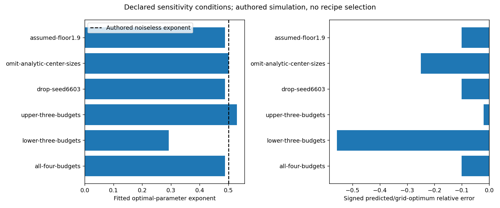

# Integrated assignments and CS336-inspired course improvement

The active implementation follows the seven P0/P1 packages in
[the comparison plan](../../docs/CS336_IMPROVEMENT_PLAN.md). The proposal was
frozen before implementation in [original-plan.md](2026-10-11-cs336-upgrade/run-01/original-plan.md).
Final independent verification passed: 1,614 tests and all 83 notebooks. This report records actual
results; it does not claim learner completion or an English-model capability gain.

All fifteen chapters now connect their mechanisms to six original
[assignments](../../docs/COURSE_ASSIGNMENTS.md), with worked checkpoints and lab
routes. Seven CPU/offline companions add 40 reference code cells and 32 plots
to the existing 76-notebook pathway. Existing notebook cells and campaign
evidence are preserved. The source implementations are original; upstream
assignments informed the scope without supplying copied prose, figures or code.

| Package | Implemented mechanism | Executed evidence and limit |
|---|---|---|
| CS33601 | Six assignments, chapter/solution/lab integration and explicit comparisons. | Complete routes through the original fifteen chapters; learner practice remains separate. |
| CS33602 | Existing byte BPE wrapped with segmentation, special admission, framed iterable encoding, save/load and likelihood-unit contracts. | Unicode/marker/boundary probes and independent byte-score arithmetic; chunks buffer a full record. |
| CS33603 | Original HTML corpus, extraction/filter ledger, MinHash/LSH candidates, exact verification/components, split and exposure audits. | Nine matched-target CPU fits; curated NLL is worse than exact deduplication on every seed. |
| CS33604 | Operation/byte ledgers, simulated roofline, timing, existing decoder checkpoint audit and phase-specific decode costs. | Actual CPU checks and bounded single-GB10 forward profile; no inferred hardware utilization. |
| CS33605 | Stable tiled attention recurrence, dense/SDPA comparisons, Q/K/V gradients, masking and broken rescaling. | CPU output/gradient correctness and logical forward workspace; no fused backward implementation. |
| CS33606 | IsoFLOPs fitting, frozen whole-budget prediction, bootstrap/refusal diagnostics and tiny measured matrix. | Authored simulation passes; 24-run empirical matrix freezes an unbracketed-optimum refusal. |
| CS33607 | Compatible supervised parent and sibling interventions, coverage control, balanced tasks, constant baselines, task-gradient and verifier audits. | Three seeds and historical 192-response strict replay; usable symbolic gradients coexist with sub-baseline held-out behavior. |

## Data and learning references

The [data reference](2026-10-11-cs336-upgrade/run-01/data/learning-reference.json)
uses three predeclared seeds and raw/exact/curated arms. Each arm presents 768
valid targets over 24 updates, using full windows with omitted tails recorded.
Retained document counts are 10/9/5. All seed rows and generated caps remain;
curation is not selected on evaluation results. The extended `TrainingSession`
preserves the old default contract and measured update/parameter behavior.

The [post-training references](2026-10-11-cs336-upgrade/run-01/posttraining/)
use a balanced parity fixture, distinct source groups and paired direct/alias
renderings. SFT uses the full ten-token vocabulary; policy rollouts use a declared
conditional two-step grammar that samples EOS. Source coverage and repetition
match supervised targets and updates. Accepted-response SFT and normalized/
centered GRPO branch from the same frozen SFT parent. Their attempted collection
and applied targets have separate denominators.

All three seeds provide sampled training/development successes and failures,
mixed groups and an independently differentiated task component. Policy final
complete-path probability remains below the always-terminated constant baseline
of 0.5. This establishes usable mechanism signal and retained shortcomings,
without establishing the learned parity relation or free-form reasoning.
Replaying the historical G4/G8 responses preserves every original strict zero
reward; the separately named richer diagnostic accepts one boxed-answer response.

## Execution and scaling

The [tiny-study specification](2026-10-11-cs336-upgrade/run-01/systems/tiny-scaling-spec.json)
declares three sizes, three calibration budgets and one untouched held-out
budget, with two seeds per cell. The added fourth budget refines the proposal's
three-budget sketch so enough calibration slices remain after holding one out.
All 24 runs finish with 18,880 presented targets. The lowest calibration budget
has its minimum at the smallest tested model, so the fit refuses an interior
optimum before collection of the held-out budget. The refusal, all test scores
and the entire held-out slice remain in
[the matrix receipt](2026-10-11-cs336-upgrade/run-01/systems/tiny-scaling-matrix.json).
The repeated finite corpus, approximate quantized `6ND` coordinate and differing
schedule horizons limit extrapolation. No empirical exponent is inferred.

The [frozen Spark profile](2026-10-11-cs336-upgrade/run-01/systems/spark-profile-01/frozen-protocol.json)
ran on the verified Linux/aarch64 GB10 host using a task-local prefix reading the
existing platform GPU dependencies. It did not synchronize the CPU lock into
the shared platform environment. The existing platform memory wrapper applied
an 8 GiB cgroup cap, with an outer timeout and between-repetition host/allocator
checks. The [actual receipt](2026-10-11-cs336-upgrade/run-01/systems/spark-profile-01/result.json)
finished successfully in approximately 0.884 seconds of runner time. Across
batch/length shapes, median decoder forward times are approximately 0.66–0.68 ms.
The near-flat tiny timings do not establish a compute or bandwidth bottleneck.
CUDA allocator peaks are approximately 34–36 MiB and exclude total host/UMA use.
The exact fused SDPA kernel was not inspected. The
[precision supplement](2026-10-11-cs336-upgrade/run-01/systems/spark-profile-01/precision-supplement.json)
records observed defaults separately from the original receipt.

## Preservation and remaining evidence

The [intake](2026-10-11-cs336-upgrade/run-01/intake.json) and
[production baseline](2026-10-11-cs336-upgrade/run-01/baseline.json) bind the
starting state. Historical acceptance criteria and result files remain their
original records. Animation opportunities extend existing candidates, with one
new scaling candidate; proposal capture appends to the existing source, and
does not authorize rendering. P2 distributed/Triton work, publication and Mac
execution are outside this goal. The optional native audit is executed below. A later native SFT/RL comparison remains unexecuted and requires its own declared recipe and scientific gates.

## Separate phase supplement

The [phase specification](2026-10-11-cs336-upgrade/run-01/systems/phase-profile-spec.json) was frozen before the [supplemental Spark run](2026-10-11-cs336-upgrade/run-01/systems/spark-phase-profile-01/result.json). It separates synchronized host elapsed spans, CUDA-event stream spans and a seeded input-generation/transfer/forward pipeline. Each phase retains three repetitions of ten calls after five warmups. Event spans can include idle gaps; neither span is a sum of individual kernel execution times. A separate short profiler trace records actual kernel names, including the baseline memory-efficient attention kernel, without assigning that kernel to every earlier profile call. The implementation name containing `sm80` does not identify the host as an A100.

The run completes in approximately 1.338 seconds, with approximately 36.4 MiB CUDA allocator peak. Small overlapping repetitions do not isolate transfer overhead by subtracting medians. Its [independent review](2026-10-11-cs336-upgrade/run-01/systems/phase-profile-peer-review.json) reconciles all timing rows and the trace identity. Original runner bytes are retained beside the old receipts, since adding this separate mode changed the runner's source hash.

## Native reward interface audit

The [native launch declaration](2026-10-11-cs336-upgrade/run-01/posttraining/native-launch-01.json) freezes the protocol identity, offline model snapshot and limits. The [executed report](2026-10-11-cs336-upgrade/run-01/posttraining/native-audit-01/report.json) retains all 48 responses from twelve independently authored training/development prompts across easy, signed and composed arithmetic. The pinned Qwen3-0.6B Instruct parent runs BF16 on the actual GB10 with thinking disabled and full sampling support. No optimizer updates or held-out observations are involved. The audit completes in approximately 107.8 seconds, with approximately 3.565 GiB CUDA allocated peak, 1,141 valid response tokens, 28 natural stops and 20 caps. Parent state hashes remain identical.

Both splits have zero strict successes, no mixed groups and zero independently differentiated task-only head gradients. All 48 richer grades are `UNSUPPORTED`. This is a failed signal gate under the declared reward/extraction interfaces. Some emitted responses visibly contain correct arithmetic: one retained response states `2 + 3 = 5` and finishes with a Markdown-emphasized answer. The strict bare-integer checker and the richer boxed-or-final extraction policy reject that format. These observations identify an interface problem; unsupported grades do not establish incorrect arithmetic. The head audit holds hidden states detached and differentiates a private output-weight clone, so it does not claim the whole-model gradient of tied weights. Its CPU tests include an independent softmax outer-product reference.

The predeclared rule stops at the diagnostic when task signal is absent. A longer RL run is therefore not executed. Future same-parent SFT/RL work needs a new reward/interface contract and its own frozen comparison; the original native zero-reward history remains unchanged.

## Sensitivity of a fitted simulation

The [bounded sensitivity reference](2026-10-11-cs336-upgrade/run-01/systems/scaling-sensitivity.py) reuses the existing scaling fitter with four noisy authored calibration budgets. Six conditions are declared before fitting: all budgets, lower/upper three, one omitted seed, omitted central sizes and a changed assumed floor. Every prediction is frozen before the target-budget rows are generated; none is selected using target errors. The [receipt](2026-10-11-cs336-upgrade/run-01/systems/scaling-sensitivity-01/receipt.json) retains all conditions and the entire held-out slice. The optimal-parameter exponent varies approximately from 0.292 to 0.530 for the lower/upper ranges, illustrating sensitivity even when the noiseless authored exponent is 0.5. This is simulation evidence, not an empirical large-model exponent.

Regenerate this standalone plot by running the retained reference in the isolated CPU environment. The source, frozen specification and all predictions preserve the distinction between sensitivity analysis and held-out recipe selection.

## Final verification and completion

The [frozen full-panel receipt](2026-10-11-cs336-upgrade/run-01/final-verification-01/cpu-verification.json) records all six local commands passing, 1,614 tests, 55 math files/1,871 expressions and zero prose/navigation/contract issues. All 83 fresh notebooks pass with 575 executed reference cells, 242 images and four preserved unfinished learner cells. Source and lesson hashes remain stable throughout the run. The contract ledger reviews 376 prompt/reference pairs and explicitly distinguishes 76 historical routes from seven frozen introduced sources, plus ten original ignored checkpoint captures.

After that panel, the reader guide's count was corrected from 76 to 83. The [documentation delta](2026-10-11-cs336-upgrade/run-01/reader-guide-delta.json) binds before/after hashes and separate passing math, prose and navigation logs. Code and notebook inputs remain the exact tested revision. This small documentation correction does not require repeating the training references or full test suite.

Original acceptance sections remain identical to the frozen proposal. All 76 original notebook files are byte-for-byte identical to the production base. Of 5,777 protected historical paths, 5,776 remain byte-identical; the animation proposal file retains its complete old prefix with candidate additions appended. Existing upgrade criteria and empirical records are untouched. Independent reviews cover data, systems, compatible post-training, book routes and actual native/GPU evidence. The [completion receipt](2026-10-11-cs336-upgrade/run-01/completion.json) binds the final source and review identities without rewriting historical receipts.

The sensitivity script intentionally refuses an existing output directory. To regenerate its standalone plot, copy the retained script into a new empty report directory and run that copy with `PYTHONPATH=src` from the repository root in the isolated CPU environment. Its fixed child output directory will then be new; earlier evidence remains intact.

The implementation goal is complete. Learner Day 9 and the coherent-English-story objective remain unchanged. Distributed/Triton production, native training follow-through, animation rendering and publication remain separate work.
